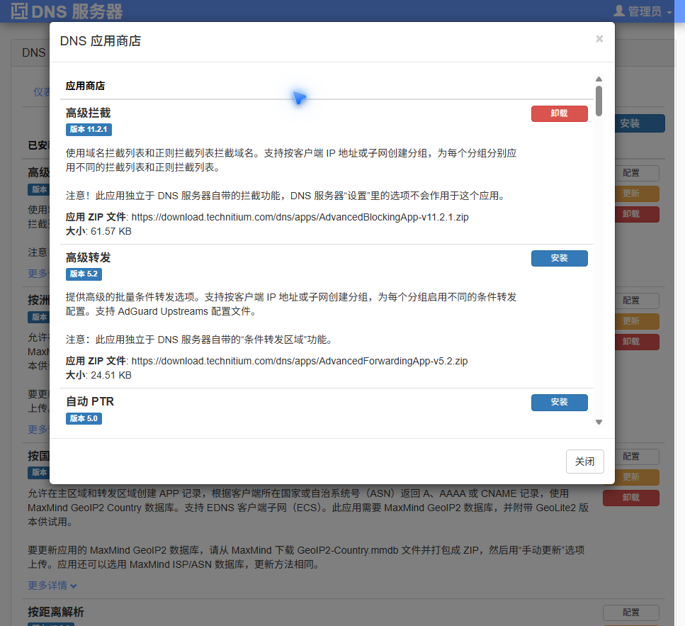

# Technitium DNS Server 简体中文汉化

非官方社区汉化补丁，基于 [Technitium DNS Server](https://github.com/TechnitiumSoftware/DnsServer) v15.6.2，按 GPLv3 分发。

这个仓库只放汉化补丁、语言包、托盘 DLL 和安装说明，不复制完整上游源码。

## 包含什么

- **Web 控制台**：`webui/js/i18n-zh.js`、`i18n-zh-help.js`、`i18n-zh-apps.js`
- **应用商店**：当前 27 个应用的名称和简介已翻译；应用页“已安装应用”也翻译
- **系统托盘**：`tray/DnsServerSystemTrayApp-zh.dll`，右键菜单、关于窗口、管理 DNS 提供商窗口、主要消息框已中文化
- **一键语言包**：`dist/Technitium-DNS-Server-中文语言包.zip`
- **源码补丁**：`patches/technitium-dns-zh.patch`，包含 Web UI 和托盘源码改动



## 安装 Web 控制台汉化

先备份 Technitium 的 `www` 目录，然后用管理员 PowerShell：

```powershell
Expand-Archive .\dist\Technitium-DNS-Server-中文语言包.zip -DestinationPath .\dist\package -Force
cd .\dist\package\Technitium-zh-CN
.\install-zh.ps1
```

默认安装目录是 `C:\Program Files (x86)\Technitium\DNS Server`；装在别处时：

```powershell
.\install-zh.ps1 -InstallDir 'D:\Technitium\DNS Server'
```

安装脚本会备份 `index.html` 和相关 JS，然后把三个脚本放到 `www\js`，并在 `</body>` 前插入：

```html
<script src="js/i18n-zh-help.js"></script>
<script src="js/i18n-zh-apps.js"></script>
<script src="js/i18n-zh.js"></script>
```

装完在浏览器按 `Ctrl + F5` 强制刷新；不用重启 DNS 服务。

## 安装系统托盘汉化

关闭正在运行的托盘程序，然后用管理员 PowerShell：

```powershell
cd .\tray
.\install-tray-zh.ps1
```

脚本会停止旧托盘进程、备份旧 DLL、替换成中文 DLL、再启动托盘。默认安装路径同样是 `C:\Program Files (x86)\Technitium\DNS Server`。

## 卸载

Web 控制台：

```powershell
cd .\webui
.\uninstall-zh.ps1
```

托盘：停掉托盘进程，把最近的 `DnsServerSystemTrayApp.dll.bak-zh-*` 改名回 `DnsServerSystemTrayApp.dll`，再启动托盘。

## 兼容性

- 目标版本：Technitium DNS Server `v15.6.2`
- Web UI 只改浏览器端显示，不改 DNS 服务、配置、缓存和查询日志
- 托盘 DLL 程序集版本 `7.0.3.0`，目标框架 `net10.0-windows7.0`
- 升级 Technitium 后，`www` 目录会被覆盖；升级完重新安装语言包即可
- 升级后如果托盘程序版本变化，不要直接覆盖新 DLL；用 `patches/technitium-dns-zh.patch` 重新构建

## 已知限制

- 应用商店的简介是动态内容；当前按 27 个应用逐条翻译，新上架或应用改简介时会先显示英文原文
- Technitium 服务端 C# 返回的 API 报错、查询日志正文、DNS 记录内容仍保持英文/原文
- `DNS`、`DNSSEC`、`DoH`、`DoT`、`TTL`、`SOA`、`NSEC3` 等技术缩写按惯例保留
- 这个补丁不是 Technitium 官方项目，不要向官方仓库提交汉化 issue

## 校验

```powershell
Get-FileHash .\dist\Technitium-DNS-Server-中文语言包.zip -Algorithm SHA256
Get-FileHash .\tray\DnsServerSystemTrayApp-zh.dll -Algorithm SHA256
```

完整哈希见 `SHA256SUMS.txt`。

## 源码补丁用法

补丁相对上游提交 `6f3aef8` 生成。克隆对应版本后应用：

```powershell
git clone https://github.com/TechnitiumSoftware/DnsServer.git
cd DnsServer
git checkout 6f3aef8
git apply --ignore-whitespace ..\patches\technitium-dns-zh.patch
```

`--ignore-whitespace` 用于兼容 Windows 的 CRLF 工作区。

## 许可与致谢

- 原项目：Technitium DNS Server，Copyright (C) 2026 Shreyas Zare，GPLv3
- 本汉化补丁同样按 GPLv3 分发，见 `LICENSE`
- 应用商店应用名称和简介的英文原文归各应用作者所有；这里只提供中文翻译
- 本仓库与 Technitium Software 无隶属关系

## 治理文档

- 安装 / 卸载 / 回滚 / 版本兼容 / 校验和：[`docs/release-and-rollback.md`](docs/release-and-rollback.md)
- 发布前检查清单：[`docs/release-checklist.md`](docs/release-checklist.md)
- 变更记录：[`CHANGELOG.md`](CHANGELOG.md)
